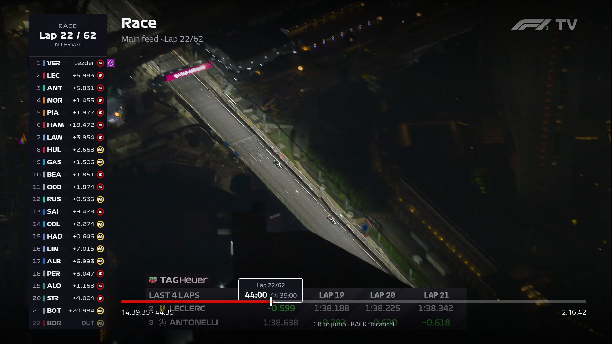
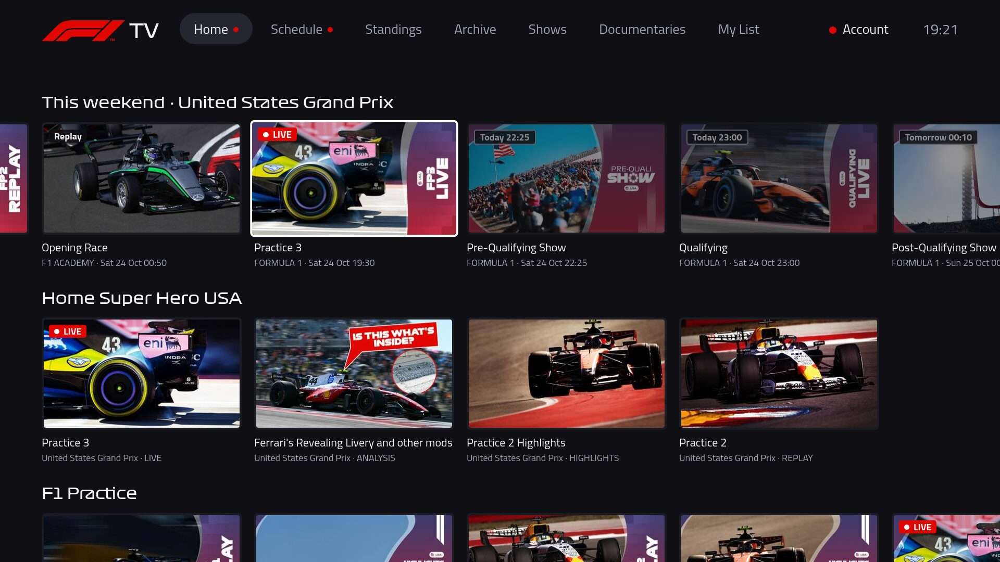
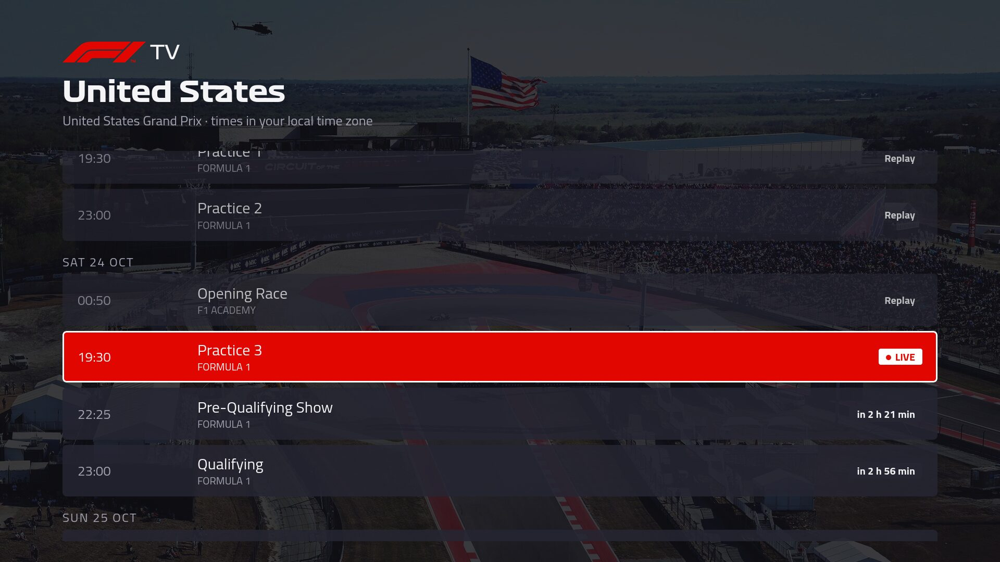
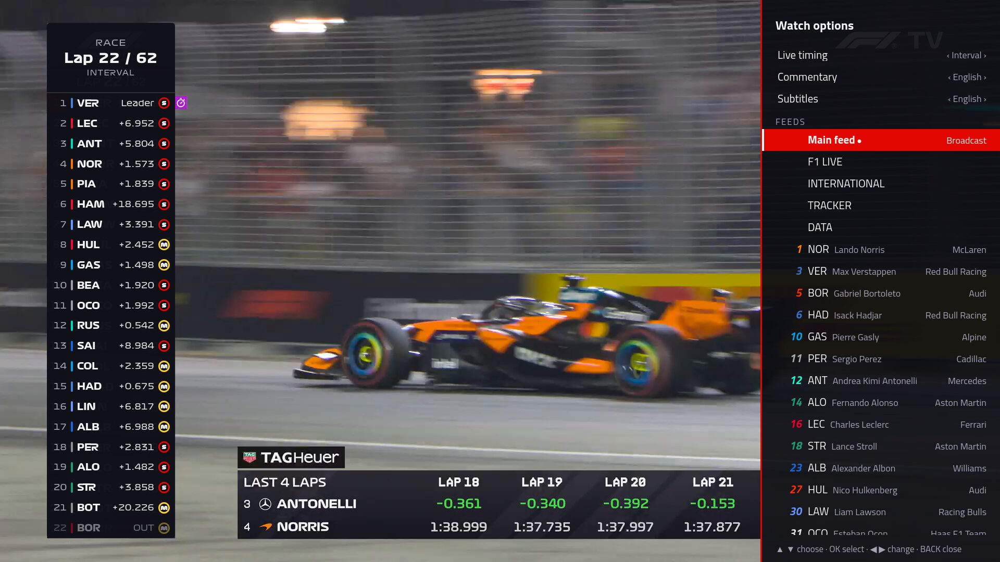
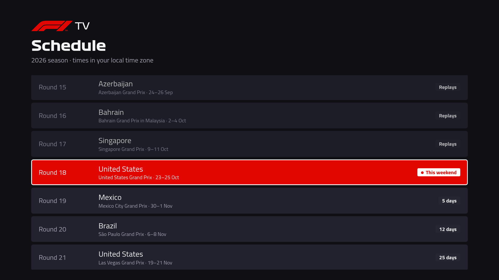
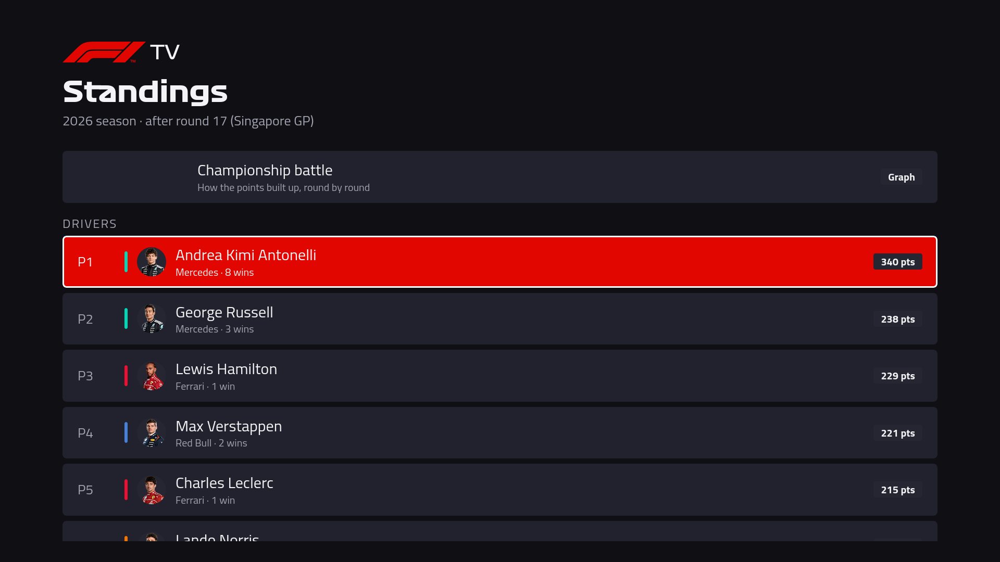
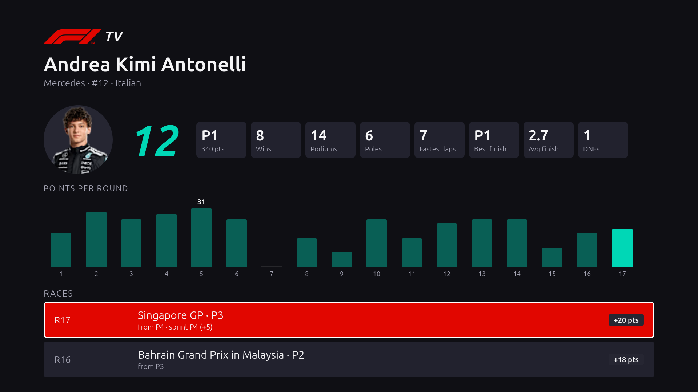
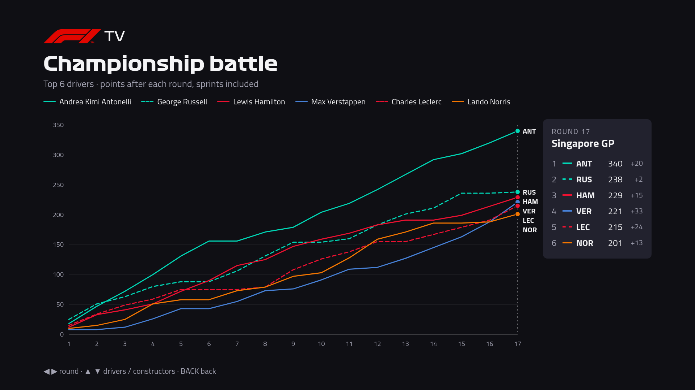

# F1 TV for Samsung TVs

[](https://github.com/nicbra/f1tv-tizen/actions/workflows/test.yml)
[](https://github.com/nicbra/f1tv-tizen/releases/latest)
[](LICENSE)

Watch F1 TV on a Samsung Smart TV that has no F1 TV app in its store: live sessions, replays,
every onboard camera, and a timing tower that stays in sync with the picture.



You need your own F1 TV subscription and, for the five-minute install, a computer on the same
network as the TV. Unofficial and not affiliated with Formula 1, F1 TV or Formula One Licensing
BV. I have shamelessly added the F1 logo in the app.

## What you get

- Video quality up to 4K 50 Hz in HDR (HLG) on TVs that support it,
  and with a subscription that gives you this.
- All of F1 TV's feeds: the main broadcast, F1 Live, an onboard camera for each driver, the
  tracker and the data channel. Switching feeds keeps you at the same moment of the session.
- A timing tower in sync with the video: positions, gaps, lap times, tyres, pit stops and track
  status. The gap times are shown with 3 decimals, that F1TV for some reason removed from their
  feed.
- Seeking shows the lap number and the time of day before you jump, so you can go straight to
  the lap you want.
- Commentary in English, German, French, Dutch, Portuguese or Japanese, or track sound only, and
  F1's subtitles, also during live sessions.
- The race weekend in your time zone: a "This weekend" row on the home screen, and a season
  calendar with every session, show and F1 Academy race.
- Standings, a page per driver with season stats and results, and a chart of how the
  championship built up round by round.
- F1 TV's home, archive, shows, documentaries and My List.
- Spoiler-free mode, which blurs the artwork of replays and highlights.
- Resume where you stopped, synced with F1 TV on your other devices.
- Sign in with a code on your phone. No passwords are typed or stored on the TV, and the TV
  renews its session on its own.

<table>
  <tr>
    <td width="50%"><br>This weekend's sessions first on the home screen</td>
    <td width="50%"><br>Every broadcast of a race weekend, in your time zone</td>
  </tr>
  <tr>
    <td><br>Watch options: timing view, commentary, subtitles and feeds</td>
    <td><br>The season calendar</td>
  </tr>
  <tr>
    <td><br>Drivers' and constructors' standings</td>
    <td><br>Season stats, points per round and every result</td>
  </tr>
  <tr>
    <td><br>How the championship built up, round by round</td>
    <td></td>
  </tr>
</table>

## Install

**1. Put the TV in Developer Mode** (once):

1. Find your computer's IP address. The installer in step 2 can help you with that.
2. On the TV, open **Apps** and press `1` `2` `3` `4` `5` on the remote (or the on-screen keypad).
3. Switch **Developer mode** to **On**, enter your computer's IP address as **Host PC IP**, and
   press OK.
4. Restart the TV: hold the remote's power button until the TV turns off and on again.

**2. Run the installer** on the computer:

- **Linux or Mac:** open Terminal and paste:

  ```sh
  curl -fsSL https://raw.githubusercontent.com/nicbra/f1tv-tizen/HEAD/scripts/install.sh | bash
  ```

- **Windows:** open PowerShell (Start menu → type `PowerShell`) and paste:

  ```powershell
  [Net.ServicePointManager]::SecurityProtocol = [Net.ServicePointManager]::SecurityProtocol -bor 3072; irm https://raw.githubusercontent.com/nicbra/f1tv-tizen/HEAD/scripts/install.ps1 | iex
  ```

The installer finds your TV, downloads Samsung's `sdb` tool and the latest app release, verifies
their checksums, then installs and launches the app. Downloads are cached in
`%LOCALAPPDATA%\f1tv-tizen` on Windows or `~/.cache/f1tv-tizen` on Mac/Linux; nothing else on
your computer is changed.

**3. Sign in:** see [Signing in](#signing-in).

### Updating

Run the installer again to update. The TV stays signed in.

The app checks for updates daily. You can also check under your name → About →
**Check for updates now**, even if automatic checks are off.

### If something goes wrong

- **TV not found or connection refused:** check Developer Mode, the Host PC IP, and that you
  restarted the TV after changing them. To specify the TV's address, use
  `… | bash -s -- 192.168.1.50` on Mac/Linux, or
  download `install.ps1` and run `powershell -ExecutionPolicy Bypass -File install.ps1 -Tv 192.168.1.50`.
- **Samsung certificate required (`[118, -12]`):** some TVs need a certificate made for that
  specific TV. Follow [Building it yourself](#building-it-yourself) using Tizen Studio's Samsung
  Certificate Extension.
- **Apple Silicon Mac:** Samsung's `sdb` needs Rosetta. The installer provides the command if
  it's missing.
- **Expired app:** Developer Mode apps can expire. Reinstall with `-s -- --force` after `bash`
  (Mac/Linux), or run the downloaded `install.ps1` with `-Force` (Windows).

## Signing in

Open the app, scan the QR code (or go to `f1tv.formula1.com/tv`) and confirm the code. If F1's
login page shows `NoSuchKey`, your browser language has no F1 login page; use
`https://account.formula1.com/#/en/login?redirect=https%3A%2F%2Ff1tv.formula1.com%2Ftv` instead.

The TV appears as an Android tablet in your F1 account's device list because the app uses that
device profile. Removing it signs the TV out.

## Questions

### Is it safe?

The app never sees your F1 password: you sign in on F1's own website, on your phone. Your F1 TV
login is only sent to formula1.com. Apart from F1, the app contacts `api.jolpi.ca` for the
standings and GitHub once a day to look for updates, which you can turn off. There is no
tracking or analytics. All the source code is in this repository, GitHub Actions builds the
release packages from it, and the installer checks them against their SHA-256 sums.

### Does it get around F1 TV's DRM?

No. The TV's own Widevine DRM decrypts the video with a license from F1 TV, the same way the
official apps do; this app does not break or bypass any DRM. You need your own subscription.

### Which TVs does it work on?

It's developed and tested on a 2021 Samsung QE55Q77A (Tizen 6.0). Other Samsung TVs with
Developer Mode may work too. Some newer models only accept apps signed with a certificate made
for that TV; see [If something goes wrong](#if-something-goes-wrong).

### Why do I need a computer?

Samsung TVs only install apps from Samsung's store, except in Developer Mode, where a computer
on the same network installs them. The app can't update itself either, so updates also go
through the installer.

## How it works

The app uses plain JavaScript compatible with Chromium 76 (Tizen 6.0). Source files are in `app/`:

- `js/api.js` handles F1 TV requests; `js/auth.js` handles pairing and token renewal.
- `js/player.js` uses **AVPlay** for encrypted streams and single-feed videos. It supports CBCS
  encryption and starts long video segments faster than Shaka. **Shaka Player** handles
  unencrypted replays with multiple feeds, preloading feed switches in the background.
- `js/timing.js` and `js/timing-worker.js` match timing data to the video's UTC timestamps.
  They use F1's timing archive for replays and SignalR for live sessions.
- `service/service.js` runs on the TV and fixes an incorrect `senc` sample count in live audio
  segments that AVPlay rejects. Video goes straight to F1's CDN; decryption stays with Widevine.

## Building it yourself

1. Put the TV in Developer Mode as described under [Install](#install).
2. Install the Tizen Studio CLI (`web-cli` installer from download.tizen.org) to `~/tizen-studio`.
3. Run `scripts/deploy.sh cert` to create a signing certificate. If your TV requires a Samsung
   certificate, create one in Tizen Studio's Certificate Manager with the Samsung Certificate
   Extension and save it as profile `f1tv`.
4. `TV_IP=<tv address> scripts/deploy.sh` builds, installs and launches the app.

For personal builds, `local/icon.png` and `local/logo.png` override the images in `app/img/`.
Files in `local/app/` override matching files in `app/`. These overrides are git-ignored and
excluded from releases. The default styles and fonts are bundled in `app/`.

Updates must use the same signing certificate. Switching certificates requires uninstalling
the app first, which signs you out; the installer prompts before doing this.

The tests need only Node.js 18 or newer and Python 3, and run on every push:

```sh
node --test tests/*.test.js
python3 -m unittest discover -s tests -p '*_test.py'
```

They cover the F1 TV API client, sign-in and pairing, how the player drives Samsung's video
player (against a fake one), the stream helper service (manifest rewriting, time-shifting, audio
fixes), the live timing data, standings and season statistics, remote navigation, settings, the
update check, and the release packaging.

[`monitor/`](monitor/README.md) checks F1's live services on a schedule, using the app's own code, and
sends a message when something the app depends on changes.

Releases are built and signed by GitHub Actions; see [docs/RELEASING.md](docs/RELEASING.md).

## Credits

- [Shaka Player](https://github.com/shaka-project/shaka-player) (Apache-2.0) and
  [qrcode-generator](https://github.com/kazuhikoarase/qrcode-generator) (MIT), bundled in `app/vendor/`.
- F1 TV API request shapes from [eXhumer/f1tv-api](https://github.com/eXhumer/f1tv-api) and
  [npanu420/F1OpenViewer](https://github.com/npanu420/F1OpenViewer).
- The background-service approach follows [TizenBrew](https://github.com/reisxd/TizenBrew).
- Standings and results from [jolpica-f1](https://github.com/jolpica/jolpica-f1) (Ergast-compatible API);
  headshots and team colours from F1's timing data.
- [Titillium Web](https://fonts.google.com/specimen/Titillium+Web) by the Accademia di Belle Arti di Urbino,
  under the SIL Open Font License 1.1 (`app/fonts/OFL.txt`).
- Formula 1 display fonts (`app/fonts/Formula1-*.woff2`) from formula1.com, owned by Formula 1.

## License

The app's own code is under the [MIT license](LICENSE). The bundled libraries and the Titillium
Web font keep their own licenses (see above). The Formula 1 fonts and logo belong to Formula 1
and are not covered by it.
